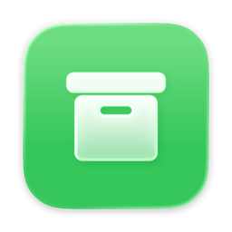
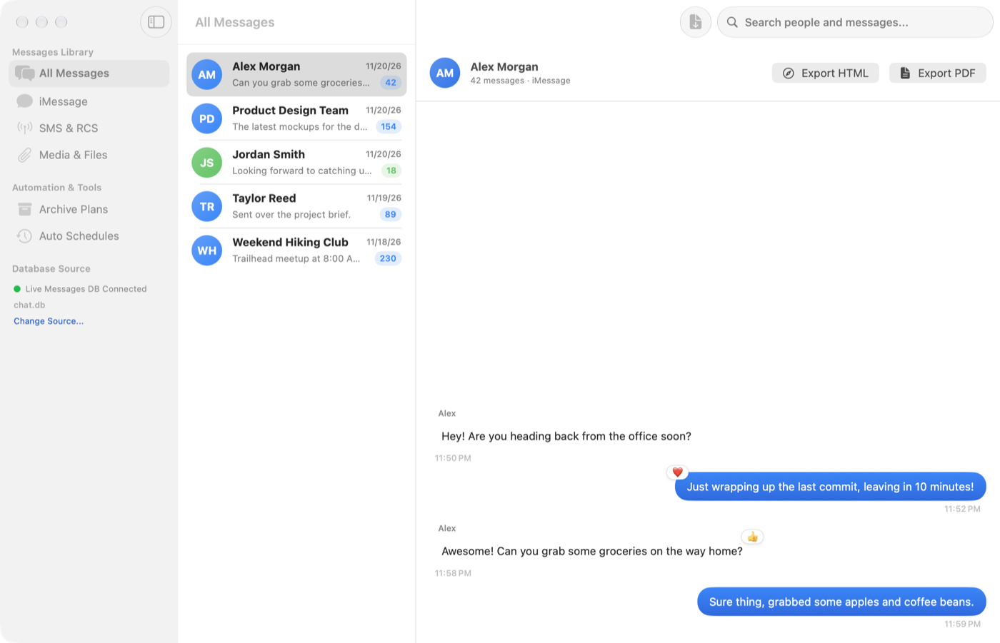
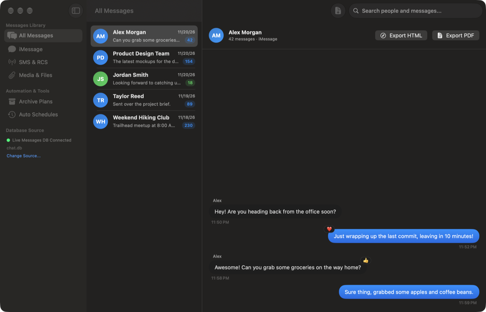
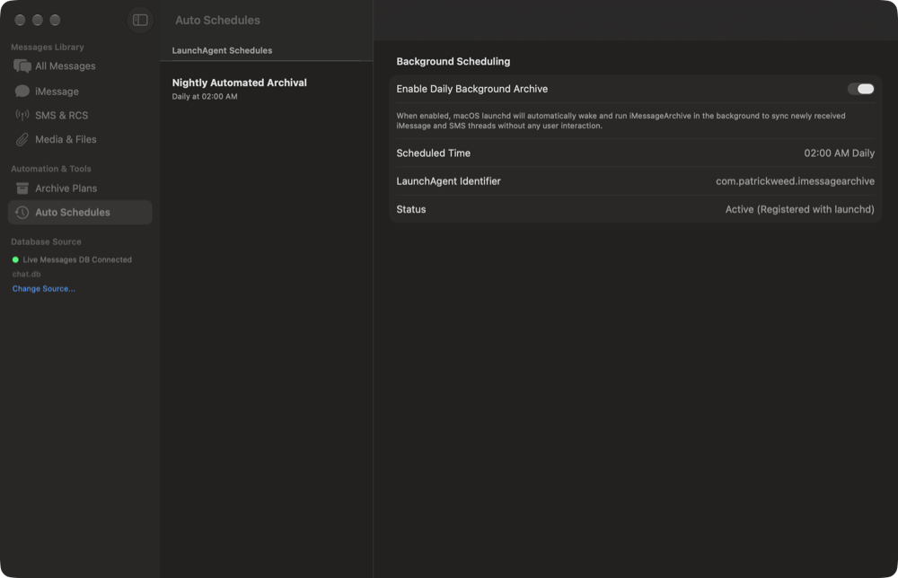

<div align="center">
  
  <h1>iMessageArchive</h1>
  <p><strong>A fast, modern native macOS app to archive, browse, search, and export Apple iMessage and SMS conversations locally.</strong></p>

  <p>
    
    
    
    
    
    
  </p>
</div>

---

## Overview

**iMessageArchive** gives you complete ownership of your messaging history. Built natively for macOS in pure Swift and SwiftUI, it connects directly to your local Apple Messages database (`~/Library/Messages/chat.db`) to provide high-speed conversation browsing, real-time contact matching, searchable standalone HTML/PDF exports, and automated incremental backups—with zero telemetry, cloud dependencies, or registration gates.

---

## Screenshots

### Light Mode
<p align="center">
  
</p>

### Dark Mode
<p align="center">
  
</p>

### Automated Background Scheduling
<p align="center">
  
</p>

---

## Key Features

- **⚡️ Direct & Lightning Fast**: Reads 100,000+ messages across thousands of conversations in milliseconds using an immutable SQLite3 engine.
- **🔒 100% Local & Private**: No cloud syncing, no third-party servers, and zero paywalls or registration dialogs.
- **👥 Seamless Contact Sync**: Automatically resolves phone numbers and emails to real names and nicknames directly from your local macOS AddressBook database (`AddressBook-v22.abcddb`) in under 30ms.
- **💬 Authentic Message Thread Inspector**: Beautiful native chat bubbles (Blue for iMessage, Vibrant Green for SMS/RCS), timestamps, sender headers, inline media previews, and floating tapback reaction badges (`❤️`, `👍`, `👎`, `😆`, `‼️`, `❓`, custom emojis).
- **📦 Incremental Archival**: Keeps full local archives in `~/Documents/iMessageArchive/` so your conversations and full-resolution media attachments remain permanently preserved even if deleted from the Messages app.
- **📄 Standalone HTML Export**: Generates self-contained, responsive HTML files with embedded styling and real-time in-browser search that open in any browser (Safari, Brave, Chrome) without needing the app.
- **📑 Formatted PDF Export**: Produces clean, paginated PDF documents with metadata headers and timestamps for legal, personal, or compliance records.
- **⏰ Unattended Automation**: Generates and manages a native macOS `launchd` LaunchAgent (`com.imessagearchive`) for scheduled nightly background backups.

---

## Technical Architecture

The project is structured into a clean multi-target Swift package:

```text
iMessageArchive/
├── Package.swift                     # macOS 26+ platform, Swift 6 main-actor isolation
├── Info.plist.in                     # App metadata, bundle ID, contacts usage description
├── build.sh                          # One-command build -> .app bundle -> codesign -> ~/Applications
├── Icon/AppIcon.icon/                # Native Liquid Glass icon (Icon Composer JSON + SVG layers)
├── Sources/
│   ├── iMessageArchiveKit/           # Core headless library (safe for CLI / unit testing)
│   │   ├── Models.swift              # Conversation, ChatMessage, Handle, Tapback, ArchivePlan
│   │   ├── MessagesDatabaseReader.swift # Read-only SQLite parser with CoreData nanosecond timestamp decoding
│   │   ├── ContactResolver.swift     # Direct AddressBook SQLite + CNContactStore resolution engine
│   │   ├── ArchiveEngine.swift       # Incremental copy engine for messages and media attachments
│   │   ├── HTMLExporter.swift        # Responsive standalone HTML generator with client-side filter JS
│   │   ├── PDFExporter.swift         # CoreGraphics PDF generator with pagination
│   │   └── SchedulerManager.swift    # macOS launchd LaunchAgent manager
│   └── iMessageArchive/              # Native SwiftUI Application
│       ├── App.swift                 # App lifecycle, menu commands, headless CLI runner
│       ├── ContentView.swift         # 3-column NavigationSplitView, message bubbles, permissions card
│       ├── Models.swift              # Observable AppModel managing UI state
│       └── SettingsView.swift        # Simplified grouped settings form
├── Tests/
│   └── iMessageArchiveKitTests/      # Automated unit tests (Swift Testing)
└── tools/
    ├── snap.sh                       # Automated light/dark window screenshot generator
    ├── selftest.sh                   # In-app integration self-test suite
    └── make_icon.sh                  # Icon compiler using xcrun actool
```

---

## Getting Started

### Prerequisites
- macOS 15.0 or later (macOS 26/27 recommended)
- Swift 6.2+ / Xcode command line tools

### Building & Installing
Clone the repository and build using the included script:

```bash
git clone https://github.com/drummerweed/iMessageArchive.git
cd iMessageArchive
./build.sh --open
```

The script compiles the release binary, builds the Liquid Glass app icon with `actool`, signs the bundle ad hoc, and installs the application to `~/Applications/iMessageArchive.app`.

### Permissions
macOS protects your Messages database (`~/Library/Messages/chat.db`) with Full Disk Access. On first launch:
1. When prompted by the app banner, click **Open System Settings**.
2. Enable **Full Disk Access** for `iMessageArchive`.
3. *Alternative*: You can also click **Select Backup Folder...** to point to an external or copied `chat.db` folder without granting Full Disk Access.

---

## Verification & Testing

Run unit tests directly:
```bash
swift test
```

Run the in-app self-test suite:
```bash
tools/selftest.sh
```

Generate fresh screenshot snapshots:
```bash
tools/snap.sh
```

---

## Status & Inquiries

> [!NOTE]
> **Read-Only Archive**: This repository is published strictly as a personal reference showcase. Issues, discussions, pull requests, and support questions are disabled. If you wish to adapt or modify this software, you are welcome to fork the repository for your own personal use.

---

## License

This software is for personal use and local archival. All rights reserved.
